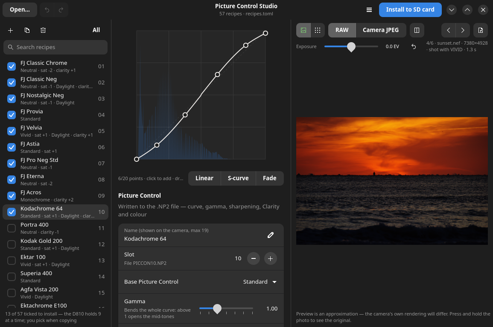
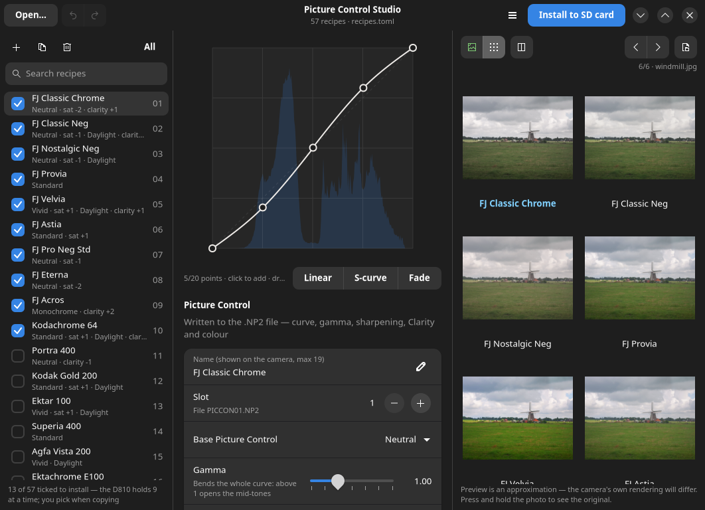
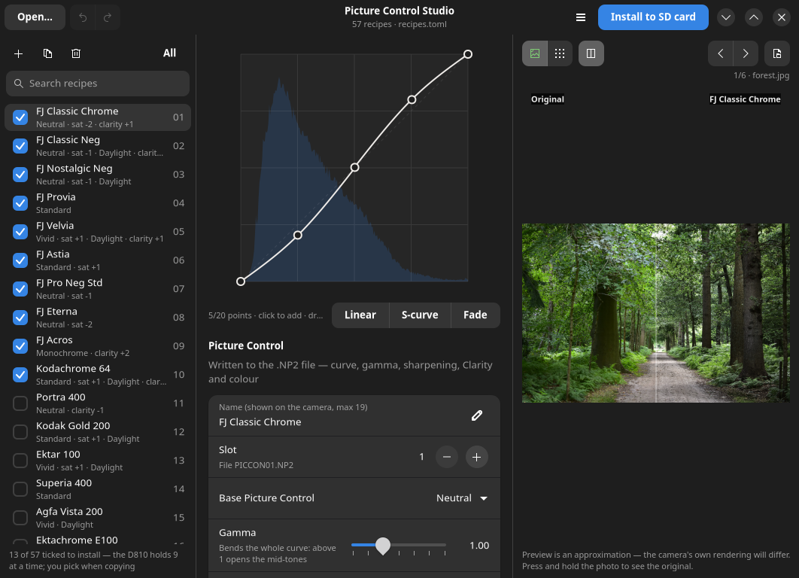

# Picture Control Studio

Design **Nikon Custom Picture Controls** — Fuji-style film simulations, classic film stocks or your own
looks — preview them on your own RAW files, and install them straight onto the camera's SD card.

Built for the **Nikon D810**. It writes the camera's own file formats (`.NP2` and `.NCP`), so the look
is applied in-camera to JPEGs, the viewfinder preview and the embedded preview in every NEF.



## Features

- **57 ready-made recipes** — Fujifilm simulations (Classic Chrome, Classic Neg, Nostalgic Neg, Provia,
  Velvia, Astia, Pro Neg Std, Eterna, Acros), Kodak, Fuji, Agfa, cinema and instant film stocks,
  creative looks and black & white.
- **Tone-curve editor** with up to 20 points, gamma, and the image's histogram behind it.
- **All Picture Control settings**: base (Standard, Neutral, Vivid, Flat, Monochrome, Portrait,
  Landscape), sharpening, **Clarity**, saturation, hue, filter effect and toning.
- **Live preview on your own photos** — NEFs are developed from the raw sensor data (via LibRaw), so the
  look is judged on its own; switch to the camera's embedded JPEG to compare.
- **All Looks** grid: your photo with every recipe at once.
- **Before / after** with a draggable divider, exposure control, folder browsing and multi-select.
- **Install to SD card**: finds the card, writes only what changed, and ejects it.
- **Export** finished JPEGs at full resolution (single photo or a whole selection), single
  `.NP2`/`.NCP` files, and a printable **cheat sheet** of the white-balance settings to dial in.
- Undo/redo, search, keyboard shortcuts, autosave; import existing `.NCP`/`.NP2` files.





## Download

Get the latest build for your system from the
[**Releases**](https://github.com/HugoDijkstra/picture-control-studio/releases/latest) page:

| System | File | Notes |
|---|---|---|
| Linux (x86-64) | `PictureControlStudio-linux-x86_64.tar.gz` | Extract and run `PictureControlStudio/PictureControlStudio`. |
| Windows (x86-64) | `PictureControlStudio-windows-x86_64.zip` | Extract and run `PictureControlStudio.exe`. SmartScreen may warn because the build isn't signed. |
| macOS (Apple Silicon) | `PictureControlStudio-macos-arm64.zip` | The app isn't signed: right-click → **Open** the first time. |

Each download bundles everything it needs, including LibRaw for RAW previews. The packaged app keeps
your recipes in your user settings folder (`~/.config/picture-control-studio/` on Linux).

## Getting looks onto the camera

1. Tick the recipes you want in the list (the D810 holds 9 at a time; you choose which when copying).
2. Insert the camera's SD card and click **Install to SD card**. Files go to `NIKON/CUSTOMPC/`.
3. Click **Eject**, put the card in the camera (slot 1), then
   **MENU › Shooting › Manage Picture Control › Load/save › Copy to camera**, pick a look and a slot.
4. White balance can't be stored in a Picture Control. Each recipe lists the WB and fine-tune to set;
   **Menu › Camera Settings Cheat Sheet** prints them all on one page.

## Run from source

Requirements: Python 3.11+, PyGObject, GTK 4, libadwaita 1.5+, numpy, Pillow, pycairo, and LibRaw's
`dcraw_emu` (optional — without it, NEF previews use the embedded camera JPEG).

| System | Install |
|---|---|
| Arch | `sudo pacman -S python-gobject gtk4 libadwaita python-numpy python-pillow python-cairo libraw` |
| Debian / Ubuntu 24.04+ | `sudo apt install python3-gi gir1.2-gtk-4.0 gir1.2-adw-1 python3-numpy python3-pil python3-cairo libraw-bin` |
| macOS | `brew install gtk4 libadwaita pygobject3 py3cairo numpy pillow libraw` |

```sh
git clone https://github.com/HugoDijkstra/picture-control-studio
cd picture-control-studio
python3 studio.py          # the app
./install.sh               # Linux: add `picture-control-studio`, `ncp` and an app-menu entry
```

## Command line

`ncp.py` builds every recipe without the GUI:

```sh
python3 ncp.py                   # -> NIKON/CUSTOMPC/PICCONxx.NP2 / .NCP
python3 ncp.py --ncp             # old .NCP format for everything
python3 ncp.py --dump FILE.NP2   # show what's inside a Picture Control file
```

## Recipes

Recipes live in `recipes.toml` (one `[[recipe]]` block each; the header of the file documents every
field). The app edits and autosaves this file. Put personal recipes — for example Picture Controls you
imported from someone else — in `recipes.local.toml`; it's loaded too but never committed.

The film recipes are approximations of each stock's character, not official Fujifilm or Kodak
renderings. The three `FXW` black & white recipes are adapted from
[Fuji X Weekly's Nikon Z recipes](https://fujixweekly.com/2022/08/24/3-bw-nikon-z-film-simulation-recipes-1-bonus-color-recipe/).

## File formats

Nikon doesn't document its Picture Control files; the formats were worked out here:

- **`.NP2`** (Picture Control 2.0, D810 and later) — reverse-engineered from files written by a D810.
  The encoder reproduces those files byte-for-byte, including one with a custom curve and Clarity.
  Colour recipes use it: curve, gamma, Clarity and the Flat base are stored in the file.
- **`.NCP`** (Picture Control 1.0) — verified byte-for-byte against nikonpc.com's generator and against
  Picture Controls made with Nikon's Picture Control Utility. Monochrome recipes still use it, because a
  camera-written monochrome `.NP2` hasn't been decoded yet (so Clarity for B&W is set on the camera).

Byte layouts are documented at the top of [`ncp.py`](ncp.py).

## Status

- Tested on Linux (Arch, KDE Plasma / Wayland). The Windows and macOS builds come from CI and are
  smoke-tested there.
- The generated `.NP2` files match the D810's own output byte-for-byte, but loading them on the camera
  hasn't been confirmed yet. `.NCP` is the fallback (`python3 ncp.py --ncp`).
- Only the Nikon D810 has been used so far. Other Nikons that read `.NP2` (D750, D500, D850, Z
  cameras …) or `.NCP` (D300, D700, D800 …) will probably work, but haven't been tried.
- The preview approximates the camera's rendering; the camera's own JPEGs will differ somewhat.

## Credits

Screenshots use the author's own photos. Not affiliated with Nikon, Fujifilm, Kodak or any other
company; product names are trademarks of their owners.
